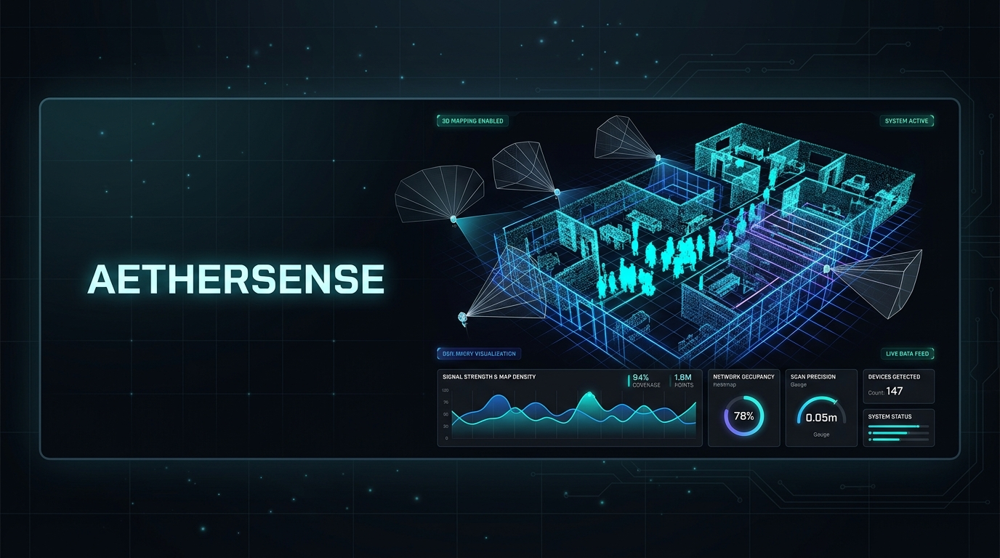

<p align="center">
  
</p>

# AetherSense

AetherSense is a C++17 Wi-Fi signal scanner paired with a Node.js/WebSocket dashboard. The browser UI turns RSSI-style measurements into an interactive Three.js scene with a virtual-emulation mode, walk paths, signal history, and saved voxel points.

> **What this is:** an experimental signal-visualization and mapping interface.
> **What this is not:** a validated occupancy radar, CSI measurement system, security scanner, or production-ready sensing platform. The 3D walls, distance estimates, and “occupancy” visuals are heuristic or simulated and should not be treated as physical measurements.



## Current implementation

- `src/core/WifiScanner.cpp` provides the native sampler. On Linux it reads `/proc/net/wireless`; when that file is unavailable or has no interface rows, it emits simulated metrics. The Linux path currently uses placeholder SSID/BSSID values rather than discovering the connected network name and access-point address.
- `src/cli_main.cpp` emits newline-delimited JSON containing `rssi`, `linkQuality`, `noise`, `channel`, `ssid`, `bssid`, and `interfaceName`.
- `web/server.js` serves `web/public`, exposes a WebSocket on the same HTTP server, starts the native CLI when it finds one, and otherwise emits a browser-facing simulated stream.
- `web/public/app.js` contains the virtual RF model, Three.js scene, camera controls, palettes, walk modes, export/import controls, and scan-history synchronization.
- Scan points are persisted as `web/scan_history.json` (ignored by Git) and retained in memory up to the server’s configured limits.

## Architecture

```text
/proc/net/wireless (Linux, when available)
        │
        ▼
C++17 wifi_scanner_cli ── newline-delimited JSON ──▶ Node.js server
                                                        │
                                      HTTP static files + WebSocket
                                                        │
                                                        ▼
                                  Three.js browser dashboard
```

If the native executable is not present, the Node server starts its own simulated signal stream. The dashboard’s **Virtual Emu** source is a separate browser-side model; it can be explored without a Wi-Fi adapter or native executable.

## Requirements

- Node.js 18 or newer (declared in `web/package.json`)
- npm
- CMake 3.15 or newer and a C++17 compiler for the native scanner
- A Linux `/proc/net/wireless` interface for Linux hardware readings; otherwise use the simulated modes
- A WebGL-capable modern browser for the 3D view

The full native visualizer target additionally requires platform graphics dependencies such as GLFW/OpenGL. The web dashboard does not require that target: the CLI target is sufficient for the Node server.

## Quick start

The commands below avoid the setup script’s optional system-package installation and build only the CLI needed by the dashboard.

```bash
git clone https://github.com/sudonishant/aethersense.git
cd aethersense

# Install the locked Node dependencies
npm ci --prefix web

# Build the native scanner (optional; omit these two commands for simulation only)
cmake -S . -B build -DCMAKE_BUILD_TYPE=Release
cmake --build build --target wifi_scanner_cli

# Start the HTTP/WebSocket dashboard
npm --prefix web start
```

Open <http://localhost:8080>. The server automatically finds `build/bin/wifi_scanner_cli` after the CMake build. To use another port, set the `PORT` environment variable before starting the server:

```bash
PORT=8090 npm --prefix web start
```

To run without native build tools, install the web dependencies and start the server directly. It will log that it is using simulated web mode:

```bash
npm ci --prefix web
npm --prefix web start
```

`setup.sh` is an alternative convenience script. It can run `apt`, `dnf`, `pacman`, or Homebrew commands when you opt into dependency installation, so inspect it and use it only when you intend to modify the host system.

## Dashboard controls

- **Real Card** consumes metrics arriving from the native/WebSocket stream. **Virtual Emu** computes a browser-side signal model with configurable router position and wall attenuation.
- **3D Mapping** and **Location Trace** change the visualization workflow; manual, auto-pilot, and LiDAR-labelled walk modes control the virtual walker. The LiDAR label is a UI mode, not a hardware LiDAR integration.
- Palette, path-loss, reference RSSI, transmit-power, shielding, frequency, FPS, and voxel-resolution controls affect the visualization or emulation calculations.
- **Clear Voxel Map** sends a `clear` WebSocket message and clears the persisted history. **Export JSON** and **Load Map** operate on browser-side map data.
- Camera orbit uses the mouse; the UI also exposes keyboard movement and waypoint controls. The exact key bindings are implemented in `web/public/app.js` and may change as the interface evolves.

## Data, privacy, and network safety

- The server has no login, authorization, origin check, or TLS configuration. Its WebSocket accepts `drop` and `clear` messages from connected clients. Do not expose it to an untrusted network or put it directly on the public Internet.
- `scan_history.json` is written under `web/` and can contain saved map coordinates and signal metadata. It is ignored by Git but remains on the host until removed; treat it as sensitive local telemetry.
- Hardware readings may reveal nearby network metadata. Use the tool only on systems and networks you are authorized to inspect, and avoid sharing exported maps or logs without reviewing them.
- The dashboard loads Three.js and OrbitControls from public CDNs in `web/public/index.html`, so a browser needs network access unless those assets are vendored locally.
- The server’s default `PORT` is `8080`; binding is not restricted to loopback by the application. Use a firewall or a local-only execution environment when appropriate.

## Project layout

```text
aethersense/
├── CMakeLists.txt              # C++17 targets and platform link settings
├── include/                    # Native scanner, buffer, math, and renderer headers
├── src/
│   ├── cli_main.cpp            # JSON-line scanner process
│   ├── core/WifiScanner.cpp    # Platform scanner and Linux fallback
│   └── visualization/          # Optional native OpenGL visualizer
├── setup.sh                    # Optional dependency installation and build helper
├── screenshots/                # Repository-provided preview assets
└── web/
    ├── package.json            # Node scripts and runtime dependencies
    ├── package-lock.json       # Locked npm dependency graph
    ├── server.js               # HTTP/WebSocket server and scanner process bridge
    └── public/                  # Browser dashboard assets
```

## Verification

There is currently no automated test suite or CI configuration in this repository. Useful local checks after making changes are:

```bash
node --check web/server.js
cmake -S . -B build
cmake --build build --target wifi_scanner_cli
npm ci --prefix web
```

The CMake build depends on the compiler and platform libraries installed on the host. A successful JavaScript syntax check does not verify browser rendering or native Wi-Fi access.

## Contributing

1. Fork the project.
2. Create a focused feature branch.
3. Run the applicable checks above.
4. Describe platform assumptions, hardware requirements, and privacy implications in the pull request.
5. Open a pull request with the smallest useful change.

## License

Distributed under the MIT License. See [`LICENSE`](LICENSE) for details. Designed and built by [sudonishant](https://github.com/sudonishant).
